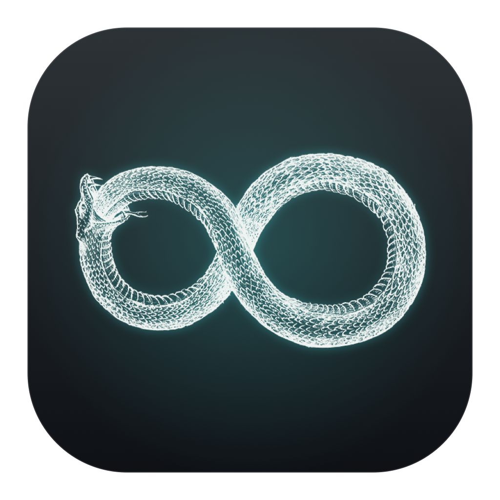
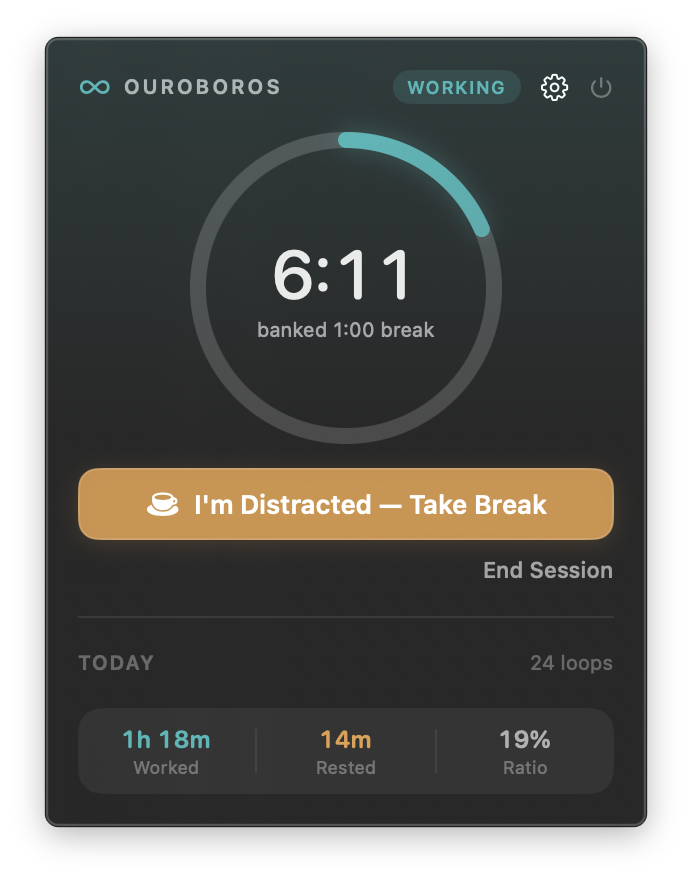
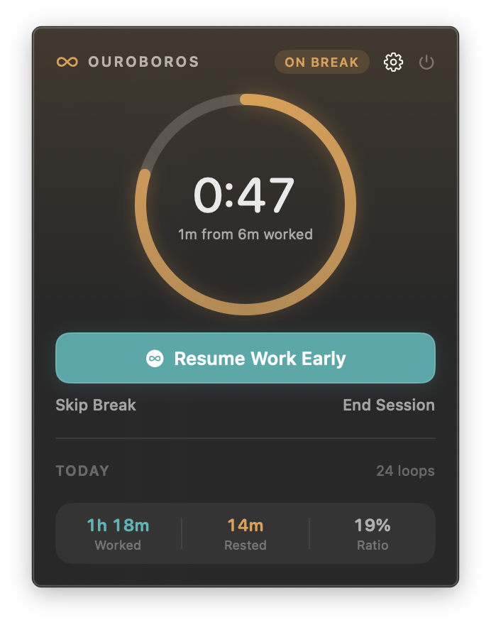

<p align="center">
  
</p>


# Ouroboros

**A menu bar focus timer where quitting is the main button, and it pays you.**

Work for as long as your focus holds. When it breaks, press one button. Ouroboros gives you back a percentage of the time you actually worked.

No Dock icon, no windows, no account.


| Working | On break |
|:---:|:---:|
|  |  |
| Counting up, open-ended | Counting down, one full circle |

## How it works

```
EarnedBreak = WorkedSeconds × ratio      (floor: 60 seconds)
```

Default ratio is 15%: one hour of work earns nine minutes of break. Pick Low (12%), Standard (15%) or High (25%) under the gear.

The 60-second floor means a two-minute work block still buys a real minute off. There is never a reason to push through.

**The loop**

```
Working ──[ I'm Distracted — Take Break ]──▶ On break ──(countdown ends)──▶ Waiting ──(you click)──▶ Working
```

| State    | Menu bar                          | Counting |
|----------|-----------------------------------|----------|
| Idle     | `infinity`                        | nothing  |
| Working  | teal, time counting up            | work     |
| On break | amber, time counting down         | break    |
| Waiting  | violet, how long it has waited    | nothing  |

## What's in the popover

A ring with the live time, one large button, and two quiet ones: **Skip Break** ends a break early and keeps the time you did take; **End Session** leaves the loop entirely.

Underneath is **today**: worked, rested, and the break ratio you actually realized, which is rarely the one you picked. Beside it is the day's cycle count — a *cycle* being one work block plus the break that followed it, recorded the moment that break closes, so "24 cycles" means you took 24 breaks.

Individual cycles are recorded and kept for 60 days but deliberately not listed. A scrolling ledger of your day is more than this popover should ask you to read.

Two smaller things: the ring pulses once for every 10 minutes of work, and the readout steps down a size past an hour so `1:14:08` doesn't jitter.

There is no Dock icon and no app menu, so **quit from the ⏻ button in the popover**, or press ⌘Q while it is open.

## Why not Pomodoro

| Pomodoro                              | Ouroboros                                         |
|---------------------------------------|---------------------------------------------------|
| Fixed 25 minutes of work              | Work as long as focus holds                       |
| Breaks are scheduled                  | Breaks are earned, proportional to real work      |
| Stopping early is failure             | Stopping early is the main button, and it pays    |
| Progress bar toward a deadline        | No invented deadline                              |
| Streaks, scores, gamification         | None                                              |

Most timers make quitting feel like failing. Here it is the mechanism.

## Who it's for

Anyone whose work doesn't fit a 25 or 50 minute box. It was built for a specific failure mode, common with ADHD: you can't start on command, you can't stop on command, and a rigid 25/5 split punishes you for both.

It is not a medical or clinical tool. It's a timer with different assumptions.

## Design decisions

- **The primary button is the exit.** The biggest control in the app is "I'm Distracted — Take Break."
- **Work has no progress bar.** Work is open-ended, so a bar filling toward an invented target would be a lie. The ring sweeps once a minute for motion. The caption shows the honest number: how much break you've banked so far.
- **Colour marks the boundary.** Teal for work, amber for rest, violet for waiting. The popover carries a wash of the phase colour, so the mode registers before you read anything.
- **The app never invents time.** When a break ends, it waits, counting nothing, until you click. If the break ran out while you were away, that time lands in no column. The log stays true, at the cost of a gap.
- **Crashes don't cost you an hour.** State is written on every transition, with a 15-second heartbeat. Relaunch within 90 seconds and the timer resumes exactly where it was. After a reboot, the block is closed at the last heartbeat.
- **Starting a break is silent. Ending one is not.** A soft chime, a time-sensitive banner, and a panel that stays until answered.
- **One setting.** Break generosity.

## Install

Beta: build from source. No signed binary yet.

```bash
git clone https://github.com/Batu-end/Ouroboros.git
cd Ouroboros
./build.sh --run
```

Requires macOS 14+ and Xcode (or the command line tools). The script builds `Ouroboros.app` next to the sources and launches it — look at the right end of your menu bar.

**To keep it:**

```bash
mv Ouroboros.app /Applications/
```

Then add it under **System Settings → General → Login Items & Extensions → Open at Login** to have it there every morning.

Note that `./build.sh` always writes the app beside the sources, so after a rebuild you need to copy it across again.

**To remove it:** quit, delete the app, and clear its stored history with `defaults delete com.batu.ouroboros`.

## Privacy

Session history lives in `UserDefaults`, as a 60-day rolling window. Nothing leaves your machine. There is no network code in the app.

## Under the hood

- Pure SwiftUI, Combine and UserNotifications. Zero third-party dependencies.
- 0.0% CPU idle, about 1.3% with a timer running and the popover closed.
- Timers use absolute date anchors, not counters, so sleep/wake and dropped ticks can't cause drift. It resyncs on wake.
- `MenuBarExtra` keeps popover content alive after closing, so an animated `TimelineView` inside it redraws at display rate forever. That cost 50% of a core until the animation was gated on actual window visibility.
- 39 tests, including rendering the ring to pixels and asserting on them.
- Agent app (`LSUIElement`): no Dock tile, no app switcher entry.

### Working on it

`swift test` runs the suite. `OUROBOROS_FAST=1 ./Ouroboros.app/Contents/MacOS/Ouroboros` makes one real second count as a minute, so a whole work → break → waiting loop takes seconds to exercise.

The icon is generated from line art rather than drawn by hand — `swift Tools/MakeIcon.swift path/to/art.jpg` keys out a flat background, recolours the ink and emits every size via `iconutil`.

If you rebuild this in an Xcode project instead of the package, the one setting that makes it a menu bar app is **Application is agent (UIElement)** — the `LSUIElement` key — set to YES in the target's Info.plist. Without it you get a Dock icon and an app menu.

## Beta status

- Tested only on the author's machine (Apple silicon, macOS 26).
- Not signed or notarized. No installer, no Homebrew cask yet. Gatekeeper will warn you about a prebuilt copy.
- Not included: sync, an iOS app, export, reports beyond today, custom ratio values, idle detection, app or website blocking.

Bugs and feedback: [open an issue](https://github.com/Batu-end/Ouroboros/issues). Reports from other macOS versions and Intel Macs are the most useful thing right now.

## License

MIT — see [LICENSE](LICENSE). Do what you like with the code.

One exception: the app icon is derived from an engraving whose rights holder is unverified, so it is not covered. Swap in your own art before redistributing a build.
